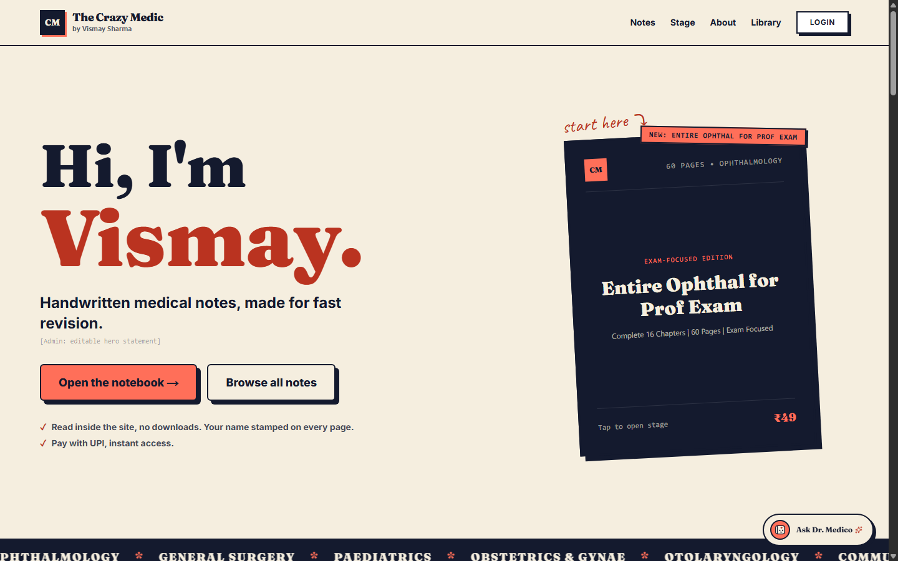
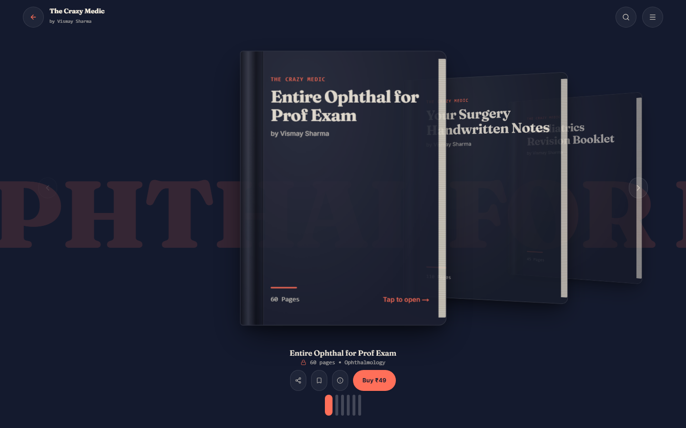
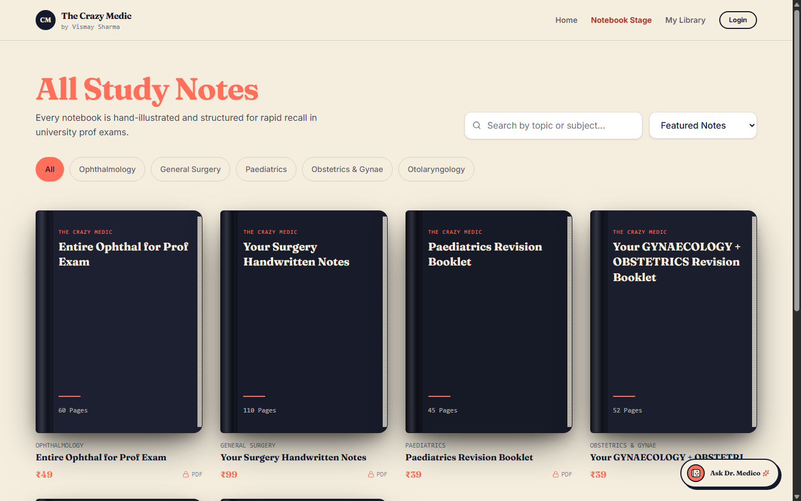
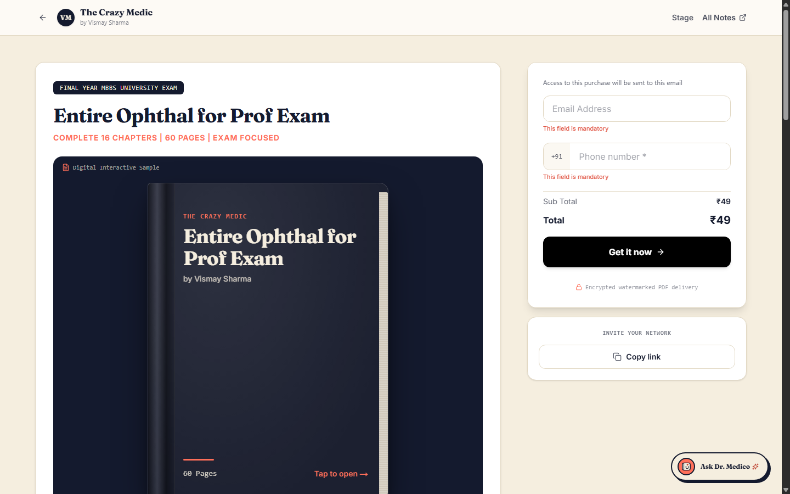
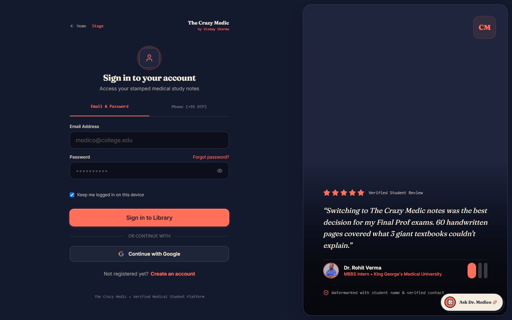
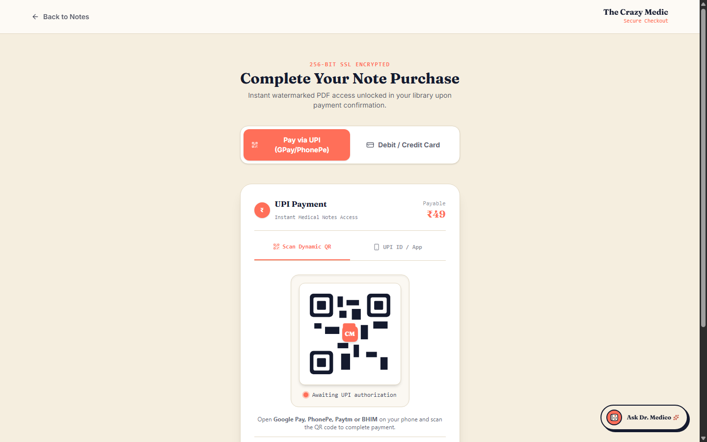

# The Crazy Medic — by Vismay Sharma

> **Handwritten medical & MBBS revision notes e-commerce platform** built with Next.js App Router, MongoDB Atlas, Auth.js v5, Razorpay, Cloudflare R2, forensic `pdf-lib` watermarking, and Gemini + Sarvam AI.

Designed around a **neo-brutalist × minimalist** visual identity (`--navy` `#141A2E`, `--cream` `#F5EEDF`, `--coral` `#FF6F59`) where **the notebook itself is the primary interface**.

---

## Visual Showcase

### 1. Neo-Brutalist Intro Landing Page (`/`)
Introduces **Vismay Sharma** with bold serif typography, hard offset borders (`6px 6px 0 var(--navy)`), marquee subject ribbon, handwritten sample spread previews, and an expanding circular-wipe transition into the 3D Stage. Automatically welcomes back signed-in students.



---

### 2. Interactive 3D Notebook Stage (`/stage`)
A focused `100dvh` coverflow stage displaying hardcover notebooks in 3D perspective. Clicking any centered notebook triggers a hinged 3D hardcover swing (`rotateY: 0deg -> -180deg`) and physical 3D leaf page turns through sample pages before locking behind checkout.



---

### 3. Responsive Study Notes Catalog (`/notes`)
Fluid multi-column hardcover catalog supporting instant topic/subject search, subject filter chips (Ophthalmology, General Surgery, Paediatrics, OBGYN, ENT, PSM), and price sorting.



---

### 4. Product Page & Interactive Checkout (`/notes/[slug]`)
Features an interactive sample book preview, complete chapter syllabus checklist, student feedback, and sticky direct-checkout card with anti-fake disposable email checks and promo coupon support (e.g., `MEDICO10`).



---

### 5. Split Auth Portal with Student Reviews (`/login` & `/signup`)
Supports **Email + Password**, **Phone (+91) SMS OTP** (via MSG91), and **Google OAuth** with 30-day persistent sessions (`authjs.session-token`), paired with a student review showcase panel.



---

### 6. UPI QR & Card Checkout + Ticket Confirmation (`/payment`)
Dynamic UPI QR authorization, 3D animated card form, server-computed Razorpay order creation & webhook verification, and confetti-animated receipt ticket.



---

## Key Features Implemented

### Core Experience & Design
* **3D Hinged Coverflow & Page Flipping:** Continuous `framer-motion` 3D cover opening swing and forward/backward paper leaf turns with dynamic spine shadows.
* **Custom Design Tokens:** Centralized navy, cream, and coral palette in `globals.css` with zero generic glass blur or fabricated stats.
* **PWA Offline Shell (`public/sw.js`):** Caches static shell & `/offline.html` while explicitly blocking caching of paid PDFs, `/viewer/*`, `/library`, and `/api/*`.

### Security, Anti-Piracy & Licensing
* **Forensic PDF Watermarking (`src/lib/watermark.ts`):** Every licensed PDF streamed from `/api/orders/[id]/download` is dynamically stamped across all pages using `pdf-lib` with the buyer's **name, email, verified `+91` phone, order ID, and purchase date**.
* **Protected PDF Viewer (`/viewer/[orderId]`):** Enforces ownership and hardware limits, blurs content on tab/window switch (**Focus Guard**), overlays repeating diagonal CSS watermarks, disables right-click context menu, hides print output, and blocks `Ctrl+S` / `Ctrl+P` / `Ctrl+C`.
* **2-Device Hardware Limit (`src/lib/device.ts`):** Binds active reading access to HTTP-only `cm_device_id` cookies capped at **2 active devices per student**. Students can inspect and revoke devices anytime from `/profile`.
* **Anti-Fake Checkout Guards:** Rejects temporary/disposable email domains (`src/lib/disposable-emails.ts`), enforces 10-digit mobile formatting, and blocks duplicate paid purchases for the same account.

### Payments, Storage & Admin Suite
* **Razorpay Orders & Webhooks:** Server-side price & coupon calculation (`/api/orders/create`, `/api/coupons/validate`), HMAC-SHA256 verification (`/api/orders/verify`), and idempotent webhook processing (`/api/webhook/razorpay`) so dropped connections still unlock access.
* **Study Library & Printable Invoices:** Real MongoDB-backed `/library`, `/orders` history, and printable HTML/PDF invoices (`/api/invoice/[orderId]`).
* **Cloudflare R2 Private Storage (`src/lib/r2.ts`):** S3-compatible presigned upload/download helper with automatic local development simulation fallback.
* **Creator Admin Dashboard (`/admin`):** Role-gated control panel with live MongoDB revenue/order/student metrics and 4 tabs:
  1. **Notes & Catalog CRUD** (`/api/admin/notes`)
  2. **Orders & Receipts** (`/api/admin/orders`)
  3. **Promo Coupons Manager** (`/api/admin/coupons`)
  4. **Students & Hardware Device Reset/Block** (`/api/admin/users`)

### AI Study Companion — "Dr. Medico" (`/api/chat`)
* Floating neo-brutalist mascot (`src/components/pet/study-pet.tsx`, hidden on `/stage` and `/viewer/*`) backed by **Gemini 2.0 Flash** and **Sarvam AI** (Hinglish & regional medical student support).
* Guardrailed server prompt: recommends only real live catalog notes, helps with MBBS exam mnemonics, and never leaks paid PDF contents.

---

## Tech Stack

| Layer | Technologies |
|---|---|
| **Framework** | Next.js 16 (App Router, Turbopack), React 19, TypeScript |
| **Styling & Motion** | Tailwind CSS v4, Framer Motion, Lucide Icons, `canvas-confetti` |
| **Database** | MongoDB Atlas + Mongoose (`User`, `Note`, `Order`, `Coupon`, `OtpToken`, `VerificationToken`) |
| **Authentication** | Auth.js / NextAuth v5 (JWT 30-day persistence, Google OAuth, Credentials, Phone OTP via MSG91) |
| **Payments & Storage** | Razorpay Node SDK + HMAC Webhooks, Cloudflare R2 (`@aws-sdk/client-s3`) |
| **PDF & Security** | `pdf-lib` forensic watermarking, device cookie fingerprinting, disposable-email blocker |
| **AI Companion** | Google Gemini 2.0 Flash + Sarvam AI |

---

## Quick Local Setup

1. **Clone & Install:**
   ```bash
   git clone https://github.com/Parths-29/Crazy_medic.git
   cd Crazy_medic
   npm install
   ```

2. **Configure Environment Variables:**
   Copy `.env.example` to `.env.local` and fill in your credentials:
   ```env
   MONGODB_URI=mongodb+srv://<user>:<password>@cluster.mongodb.net/crazy_medic
   NEXTAUTH_URL=http://localhost:3000
   AUTH_SECRET=your_random_32_byte_secret
   AUTH_TRUST_HOST=true

   # Google OAuth (Optional — add Authorized Redirect URI: /api/auth/callback/google)
   GOOGLE_CLIENT_ID=
   GOOGLE_CLIENT_SECRET=

   # Razorpay & Cloudflare R2
   RAZORPAY_KEY_ID=
   RAZORPAY_KEY_SECRET=
   RAZORPAY_WEBHOOK_SECRET=
   R2_ACCOUNT_ID=
   R2_ACCESS_KEY_ID=
   R2_SECRET_ACCESS_KEY=
   R2_BUCKET=

   # SMS OTP & AI
   MSG91_AUTH_KEY=
   MSG91_TEMPLATE_ID=
   GEMINI_API_KEY=
   SARVAM_API_KEY=
   ADMIN_EMAILS=your-admin-email@example.com
   ```

3. **Run Development or Production Server:**
   ```bash
   npm run dev
   # or production build
   npm run build && npm run start
   ```

---

## Deployment

### Vercel (Recommended)
Configured via [`vercel.json`](vercel.json) (`bom1` / `sin1` regions):
1. Import `Parths-29/Crazy_medic` in Vercel.
2. Add your environment variables from `.env.example` (set `AUTH_TRUST_HOST=true` and `NEXTAUTH_URL` to your production URL).
3. Deploy — Next.js App Router frontend and API routes run seamlessly together.

### Render
Configured via [`render.yaml`](render.yaml):
1. Create a new **Blueprint** on Render pointing to `Parths-29/Crazy_medic`.
2. Supply your secret environment variables (`MONGODB_URI`, `RAZORPAY_*`, `R2_*`, `AUTH_SECRET`, etc.).

---

**Built for The Crazy Medic — by Vismay Sharma.**
